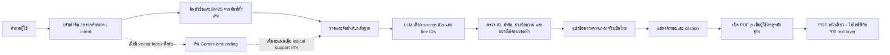

# Sorty — คู่มือเทคนิคและที่มาของแนวทาง

**ปรับปรุง:** 13 ตุลาคม 2569  
**ขอบเขต:** ระบบ Streamlit สำหรับค้นหนังสืออัลกอริทึมจาก PDF ภาษาอังกฤษ แล้วแสดงหลักฐานและคำแปลภาษาไทย  
**ผู้อ่าน:** ผู้พัฒนาคนถัดไป ผู้ตรวจโครงงาน และผู้ที่ต้องดูแลชุดข้อมูล

## การปรับเส้นทางคำถามล่าสุด — Gemini เป็นตัวหลัก

รอบแก้ล่าสุดวันที่ 13 ตุลาคม 2569 เปลี่ยนทางเข้า UI เป็น `app.submit` → `services.answering.answer_question` → `services.question_routing.interpret_question` ก่อนค้นทุกคำถามเนื้อหา Gemini ตัดสิน `direct`, `interpret`, `out_of_scope` และคืนคำค้นอังกฤษพร้อม ID หัวข้อจริงจาก dataset กฎที่เคยข้าม Gemini เมื่อรู้ชื่อ algorithm หรือพบหัวข้อเป็นวิธีเก่า คำทักทายสั้นยังตอบในเครื่องได้

`direct` ดึงหัวข้อหรือข้อความตรงตามคำถาม; คำถามธรรมชาติที่ต้องเลือกช่วงข้อความยังใช้ตัวเลือกหลักฐาน `interpret` ใช้ความหมายที่ Gemini แปลงแล้วค้น และใช้คำถามต้นฉบับกำกับการเลือกบรรทัด ถ้าระบุหัวข้อเฉพาะจะจำกัด candidates ในหัวข้อนั้น; ถ้าเนื้อหาต้องข้ามหัวข้อให้ส่ง section_id=null ข้อความคำตอบทุกส่วนประกอบกลับจาก PDF ตาม offsets ไม่ใช้ข้อความคำตอบที่ Gemini แต่ง

เพดานตีความ **1200 output tokens** เผื่อ JSON ที่มีโหมด คำค้นรักษาเงื่อนไข และ ID หัวข้อ ค่าเล็กกว่านี้อาจทำผลไม่ครบ ค่าใหญ่กว่านี้เพิ่มเพดานการใช้ token โดยยังไม่มี benchmark หาค่าที่ดีที่สุด ส่วนเลือกหลักฐาน **1800** แปล **6000** และ temperature **0** เท่าเดิม utility translate_query ที่เพดาน 400 ยังอยู่เพื่อความเข้ากันได้ แต่ UI ไม่ได้เรียกแทนขั้นตีความแล้ว

บริบทตีความมีสารบัญพร้อม ID จริง (ชุดนี้วัดได้ **295 หัวข้อ**) และคำถามที่ตอบแล้วล่าสุดไม่เกิน **2 ข้อ** ช่วยแก้การอ้างย้อนโดยจำกัดบริบท/ค่าใช้จ่าย จำนวน 2 เป็นนโยบายที่ยังไม่ทดลองปรับเทียบ Embedding เป็นส่วนเสริมหลัง Gemini ตีความ และค้นได้โดยไม่มี vector index

คำขอแต่ละขั้นมี timeout **20,000 ms** ลองสูงสุด **2 ครั้ง** เฉพาะสถานะชั่วคราว 429/500/502/503/504 และรอ **0.5 วินาที** ก่อนครั้งที่สอง ปิด retry ภายใน SDK ด้วย attempts=1 เพื่อไม่ให้ลองซ้อน ค่าเหล่านี้จำกัดเวลา/ค่าใช้จ่าย ไม่ใช่ผลเปรียบเทียบหาค่าที่ดีที่สุด ดู regression ที่ `tests/test_question_routing.py`, `tests/test_generation_retry.py` และรายละเอียดส่งต่อใน `HANDOFF_TH.md`

หัวข้อประวัติและแผนภาพเดิมด้านล่างอาจอธิบายวิธีค้นก่อนตีความ ให้ยึดเส้นทางในส่วนนี้และโค้ดปัจจุบันสำหรับการ deploy ครั้งถัดไป

เอกสารนี้รวมสถาปัตยกรรมปัจจุบัน ประวัติการแก้ปัญหาสำคัญ วิธีตรวจและสร้างดัชนี การครอปรูปด้วย Python การเปิด PDF.js พร้อมไฮไลต์ และงานวิจัย/เอกสารเทคนิคที่เป็นที่มาของแนวทาง แต่ละรายการระบุด้วยว่าโค้ดใช้วิธีนั้นจริง ใช้เพียงแนวคิด หรือยังไม่ได้เปิดใช้

> **อ่านสถานะให้ตรงกัน:** “งานวิจัยสนับสนุนแนวทาง” ไม่ได้แปลว่าระบบนี้ implement วิธีเดียวกับผู้วิจัย หรือได้ผลเหมือนผลทดลองในบทความ ผลทดสอบในเครื่องเป็นผลตรวจระบบ ไม่ใช่ผลทดลองกับผู้เรียน

## สารบัญ

1. [ภาพรวมและสถานะปัจจุบัน](#1-ภาพรวมและสถานะปัจจุบัน)
2. [แผนผังระบบ](#2-แผนผังระบบ)
3. [ไฟล์และส่วนประกอบ](#3-ไฟล์และส่วนประกอบ)
4. [PDF ต้นฉบับและการสแกน](#4-pdf-ต้นฉบับและการสแกน)
5. [แก้สัญลักษณ์คณิตศาสตร์จากฟอนต์ฝัง](#5-แก้สัญลักษณ์คณิตศาสตร์จากฟอนต์ฝัง)
6. [โครงสร้างหนังสือและการแบ่ง Chunk](#6-โครงสร้างหนังสือและการแบ่ง-chunk)
7. [การค้นและเลือกหลักฐาน](#7-การค้นและเลือกหลักฐาน)
8. [การแปลและการจัดให้อ่านง่าย](#8-การแปลและการจัดให้อ่านง่าย)
9. [รูปประกอบและการครอปด้วย Python](#9-รูปประกอบและการครอปด้วย-python)
10. [Citation, การรวมบรรทัด และ PDF.js](#10-citation-การรวมบรรทัด-และ-pdfjs)
11. [บทสนทนาและหน้าจอ](#11-บทสนทนาและหน้าจอ)
12. [Embeddings และสถานะที่ยังไม่พร้อม](#12-embeddings-และสถานะที่ยังไม่พร้อม)
13. [งานวิจัยและการนำมาใช้ใน Sorty](#13-งานวิจัยและการนำมาใช้ใน-sorty)
14. [วิธีติดตั้งและเปิดระบบ](#14-วิธีติดตั้งและเปิดระบบ)
15. [วิธีสแกนและสร้างดัชนีใหม่](#15-วิธีสแกนและสร้างดัชนีใหม่)
16. [ผลทดสอบและความหมายของตัวเลข](#16-ผลทดสอบและความหมายของตัวเลข)
17. [ปัญหาที่พบ สาเหตุ และการแก้](#17-ปัญหาที่พบ-สาเหตุ-และการแก้)
18. [ข้อจำกัดและงานต่อ](#18-ข้อจำกัดและงานต่อ)
19. [บรรณานุกรมและเอกสารทางการ](#19-บรรณานุกรมและเอกสารทางการ)

## 1. ภาพรวมและสถานะปัจจุบัน

Sorty เป็นแอป Streamlit ที่ค้นจาก PDF ภาษาอังกฤษไฟล์เดียว แสดงข้อความที่พบเป็นภาษาไทยเมื่อมี API พร้อม และให้ผู้ใช้เปิด PDF ต้นฉบับเพื่อยืนยันหลักฐานได้ ระบบไม่ใช้ฐานข้อมูลบัญชีผู้ใช้ และประวัติแชตอยู่ใน Streamlit session ระหว่างรอบใช้งาน

| รายการ | สถานะที่ตรวจจากไฟล์ปัจจุบัน |
|---|---|
| PDF หลัก | `book_data/Cormen_Basic_Sorting_100_Pages.pdf`, 100 หน้า, ภาษาอังกฤษ |
| ลักษณะเนื้อหา | ข้อความจากหนังสือและส่วนเสริมที่ติดป้าย Supplement; ไม่ควรเรียกทุกหน้าเป็นเนื้อหาต้นฉบับ CLRS |
| Dataset | 868 chunks, 1 document, 7 chapter, 64 section, 225 subsection, 855 paragraph nodes |
| คำศัพท์ค้น | 2,972 terms จากข้อความทั้งเล่ม |
| เส้นทางคำถามที่ตรวจทานไว้ | 113 query guidance routes ซึ่งชี้ไปยังหัวข้อ/หลักฐาน ไม่ได้เก็บคำตอบสำเร็จรูป |
| รูปที่ผ่านการทบทวน | 48 รูป WebP เชื่อมกับหน้าและหัวข้อใน PDF |
| คำถาม/คำตอบเสริมใน PDF | ลบออกจาก PDF ที่ใช้งานแล้ว; สแกนปัจจุบันพบหัวข้อดังกล่าว 0 รายการ |
| Embedding index | 0/868 เวกเตอร์; สถานะไม่สมบูรณ์และมีข้อผิดพลาดผู้ให้บริการ 429 ในสถานะที่บันทึกไว้ |
| โมเดลข้อความ | ใช้ชื่อโมเดลจาก `.env` หรือ environment; ค่าเริ่มต้นในโค้ด `gemini-3.5-flash-lite` |
| PDF.js | vendored ใน `ui/pdf_viewer/` รุ่น 6.4.299; runtime ไม่ดาวน์โหลดจาก CDN |

ตัวเลขชุดข้อมูลล่าสุดอยู่ใน `docs/ENGLISH_SEARCH_RESULTS.json`; สถานะเวกเตอร์อยู่ใน `vector_store/status.json`. การแปลด้วย API ขึ้นกับการตั้งค่า key และบริการภายนอก จึงไม่ใช่โหมดออฟไลน์ทั้งหมด

## 2. แผนผังระบบ



โมเดลไม่ได้เขียนข้อเท็จจริงจากความจำของตัวเองในเส้นทางตอบคำถามเนื้อหา หน้าที่หลักคือช่วยเลือกข้อความที่เกี่ยวข้องและแปลข้อความที่ค้นพบ ข้อความที่จะอ้างต้องประกอบกลับจาก offsets ใน Dataset

## 3. ไฟล์และส่วนประกอบ

| ตำแหน่ง | หน้าที่ |
|---|---|
| `app.py` | Streamlit UI, รับคำถาม, small talk, เรียก search/selection/translation, pagination และแผงหลักฐานลอย |
| `services/ingest.py` | อ่าน PDF, เก็บบรรทัดและพิกัด, สร้าง metadata, ตรวจแหล่งที่มาและความถูกต้องของ Dataset |
| `services/structure.py` | แยก heading/ข้อความ/โค้ด/สูตร และสร้าง Document → Chapter → Section → Subsection → Paragraph/Chunk |
| `services/math_repair.py` | ถอดรหัส glyph จากฟอนต์คณิตศาสตร์ที่ทดสอบกับ PDF รุ่นนี้โดยเฉพาะ |
| `services/search.py` | exact heading, ดัชนีศัพท์เต็มเล่ม, BM25, reciprocal-rank fusion และ parent expansion |
| `services/retrieval.py` | ทำความสะอาดคำถาม, aliases ไทย/อังกฤษ, ตรวจ topic/intent และแก้ typo ที่จำกัดขอบเขต |
| `services/evidence_selection.py` | สร้าง candidate pool, ขอให้ LLM เลือก IDs/ช่วงบรรทัด, ตรวจคำตอบของ selector และทำช่วงร้อยแก้วให้ครบ paragraph |
| `services/answering.py` | คุมเส้นทางตอบ, exact lookup, selection, refusal/fallback และรักษาข้อความต้นทาง |
| `services/translation.py` | แปลคำถามและหลักฐาน, ป้องกันสูตร/เลข/โค้ด และตรวจ marker ก่อนรับคำแปล |
| `services/formatting.py` | เครื่องมือแผนจัดข้อความแบบเดิม/ทางเลือก; ไม่ใช่ตัวสร้างคำตอบที่ UI ใช้ในเส้นทางปัจจุบัน |
| `services/images.py` | คัดเฉพาะรูปจริงที่ผ่านการตรวจและสัมพันธ์กับหลักฐาน |
| `services/vectors.py` | fingerprint, Gemini embedding provider, ตรวจรุ่น/มิติ/task และค้น cosine เมื่อ index สมบูรณ์ |
| `scripts/rescan.py` | สร้าง metadata และภาพจาก PDF ภาษาอังกฤษที่อนุมัติ |
| `scripts/build_vectors.py` | สร้าง embeddings แบบแบ่งชุดและต่อจาก progress เมื่อ API พร้อม |
| `scripts/remove_pdf_editor_qa.py` | เครื่องมือ redaction สำหรับลบกลุ่ม Q&A ในอนาคต เมื่อพบจริงและทำตามขั้นตรวจสอบ |
| `metadata/*.json` | Dataset, chunks, hierarchy, pages, รูป, query routes, ดัชนีศัพท์, math map และ metadata เอกสาร |
| `assets/images/en/` | ภาพประกอบ WebP ที่ผ่านการตรวจ |
| `ui/evidence_groups.py` | รวมบรรทัดติดกัน, แบ่งหน้าแสดงผล และจัดกลุ่มหลักฐานต่อหน้า PDF |
| `ui/document_viewer.py` | สร้าง payload PDF หน้าเดียว, แปลงพิกัด และสร้างไฟล์หน้า PDF พร้อม annotation สำหรับดาวน์โหลด |
| `ui/pdf_viewer/` | viewer PDF.js และ JavaScript จัดการโหลด/เรนเดอร์/ไฮไลต์ |
| `tests/` | unit, pipeline, Streamlit AppTest และ JavaScript geometry/loader tests |
| `OLD/` | สำรอง runtime/PDF/data เก่าที่เก็บไว้เพื่อย้อนดู; ไม่ใช่ข้อมูลค้นใน runtime ปัจจุบัน |
| `docs/` | รายงาน rebuild, audit, root cause, research notes และผลทดสอบ |

## 4. PDF ต้นฉบับและการสแกน

### ขอบเขตข้อมูล

PDF ที่ค้นจริงอยู่ที่ `book_data/Cormen_Basic_Sorting_100_Pages.pdf` และค่า SHA-256 ที่ Dataset ปัจจุบันบันทึกคือ `ec147b61a9beee8b5227a0b2dea0fbf07d7c99b15ba9acd0b5053b9890293509`. ภาษาไทยที่เก็บหรือเคยสร้างไว้ใน `OLD/` ใช้ดูประกอบ/เปรียบเทียบเท่านั้น ไม่ใช่แหล่งค้นหรือแหล่งตอบ

ชื่อไฟล์ระบุ 100 หน้าและตัวอ่านยืนยัน 100 หน้า แต่ตัวเอกสารมีทั้งข้อความจากหนังสือและ Supplement ที่ผู้ทำข้อมูลเพิ่ม ต้องรักษา `source_kind` ไว้ในการอ้างอิง และไม่ทำให้ Supplement ดูเหมือนเป็นหน้าต้นฉบับหนังสือ

### การสกัดข้อมูล

`services/ingest.py` ใช้ PyMuPDF อ่าน PDF ด้วยโครงสร้าง text dictionary และตำแหน่ง ไม่ได้ใช้ OCR เต็มหน้าเป็นค่าเริ่มต้น ทุกบรรทัดเก็บ `page`, `line id`, `text`, `raw_text`, `bbox`, `char_start/end`, spans, font, size, role และ block ID. ID บรรทัดในรูปแบบ `p36-l15` อ้างถึงลำดับบรรทัดที่สกัดจากหน้า ไม่ได้หมายถึงเลขบรรทัดที่พิมพ์ไว้ในหนังสือ

หัวกระดาษ/เลขหน้า running header แยกจากข้อความเนื้อหาโดยอาศัยตำแหน่งบนหน้า เช่น ขอบบน/ขอบล่างและรูปแบบเอกสาร ส่วนคำกำกับภาพตรวจเทียบกับกรอบรูปที่ผ่านการทบทวน จึงไม่เอาป้ายตัวอักษรในภาพไปสร้างเป็น heading โดยอัตโนมัติ

Dataset บันทึก hash ของ PDF ต้นฉบับและตรวจว่า offsets ของทุก chunk ชี้กลับไปยังข้อความในหน้าจริง พิกัดต้องอยู่ในขอบหน้า และไฟล์รูปต้องมีอยู่/ชี้กลับเอกสารและ hash ที่ถูกต้อง หากเปลี่ยน PDF ต้อง rebuild และตรวจ asset ที่ผูกกับ hash ก่อนอนุมัติ hash ใหม่ อย่าแก้ metadata hash ด้วยมือเพื่อข้ามการตรวจ

## 5. แก้สัญลักษณ์คณิตศาสตร์จากฟอนต์ฝัง

PDF ใช้ character map ในฟอนต์คณิตศาสตร์บางชุดที่ถอดเป็น Unicode ผิด เช่น เครื่องหมายเท่ากับ/บวกถูกอ่านเป็นตัวอักษรอื่น หรือเศษส่วน/วงเล็บปรากฏเป็นอักขระแปลก การแทนที่ global ด้วย regex เสี่ยงเปลี่ยนตัวอักษรเดียวกันในเนื้อหาปกติ

`services/math_repair.py` จึงผูก mapping กับทั้ง SHA ของ PDF และ hash ของ embedded font ใช้ข้อมูล glyph ID และฟอนต์เฉพาะจุดจาก text trace ก่อนแทน ผลลัพธ์เก็บ `raw_text` และบันทึกตำแหน่ง repair ไว้ การแก้ math layer ครั้งแรกไม่เขียนทับ PDF; PDF เปลี่ยนในงานถัดมาคือการลบ Q&A ซึ่งเป็นคนละการเปลี่ยนแปลงและตรวจด้วย image diff

ผล audit ที่บันทึก: ซ่อม 768 บรรทัดและบันทึก 3,079 การเปลี่ยน glyph (รวมเหตุการณ์ subscript/superscript ที่ตรวจคืนได้) ตัวเลขนี้นับการแปลง glyph ไม่ได้แปลว่าสูตร 3,079 สูตรถูกต้องทั้งหมด กรณีลำดับอ่านเศษส่วนหลายชั้น, summation limits และ glyph ที่ไม่อยู่ใน mapping ยังต้องเปิดภาพ PDF ตรวจ ห้ามเดาคณิตศาสตร์จากตัวสะกดที่เสีย

หลักฐานและ mapping อยู่ใน `metadata/math_glyph_map.json`, `docs/MATH_REPAIR_RESULTS.json` และโฟลเดอร์ backup ภายใต้ `OLD/math-text-repair-2026-10-13/`. รายงาน math repair บางส่วนเกิดก่อน redaction PDF ภายหลัง จึงใช้ hash/จำนวนหน้าในรายงานล่าสุดของ Dataset เป็นสถานะปัจจุบัน

## 6. โครงสร้างหนังสือและการแบ่ง Chunk

### ลำดับชั้น

หัวข้อถูกแทนเป็น parent-child tree: **Document → Chapter → Section → Subsection → Paragraph**. แบบฝึกหัดที่มีเลขหลายระดับอาจเป็น subsection ซ้อนเพิ่มตามลำดับ heading ของต้นฉบับ โดยไม่มีการย้ายข้อความจากหน้าหนึ่งไปอีกหัวข้อเพียงเพราะชื่อคล้ายกัน

ตัวหา heading ใช้ bookmark/TOC เป็นหลักเมื่อมี และเสริมด้วยขนาดฟอนต์ น้ำหนักตัวอักษร ความยาว/เครื่องหมายปิดประโยค และรูปแบบบรรทัด รักษา `heading_path`, `parent_id`, `child_ids`, `chunk_ids`, หน้าเริ่ม/จบ และพิกัด ทำให้ค้นชื่อหัวข้อแล้วขยาย chunk ลูกทั้งหมดตามลำดับหนังสือได้โดยไม่ฝากให้ LLM สรุปเนื้อหาหัวข้อเอง

ปัญหาเก่าที่สำคัญคือข้อความใน diagram มีฟอนต์เล็กกว่าตัวเนื้อหา จนทำให้ค่าขนาด font กลางเอนผิดและประโยคร้อยแก้วธรรมดาถูกจัดเป็น heading แก้โดยหาขนาดตัวเนื้อหาจาก span ร้อยแก้วปกติ ตัด label ภาพ, Courier, Symbol/MT2, bold และ italic ออกก่อน แล้วใช้ fallback เฉพาะเมื่อไม่มีข้อความประเภทนั้น

### Chunking

- เริ่มจาก line spans ของหน้าและกลุ่มบรรทัดที่อยู่ใน paragraph เดียวกัน ใช้ role, block ID, ช่องว่างแนวตั้ง/การเยื้อง และเครื่องหมายจบประโยคช่วยแบ่ง
- เป้าหมาย chunk สูงสุด 1,800 ตัวอักษร แบ่งตามแนวบรรทัด ไม่มี overlap; ถ้าบรรทัด/paragraph หนึ่งยาวกว่าเป้าหมายจะไม่ตัดกลางบรรทัดโดยไร้เหตุผล
- paragraph ที่ต่อข้ามหน้าเก็บ `paragraph_id` เดียวกันเมื่อตรงเงื่อนไข continuation (หัวข้อ/parent เดียวกันและหน้าก่อนจบไม่สมบูรณ์)
- ระหว่างค้น หาก selector เลือกบางบรรทัดในร้อยแก้ว ระบบขยายเป็น paragraph ต้นฉบับทั้งหมด รวม continuation ที่มี paragraph ID เดียวกัน ไม่ขยายทั้ง section โดยอัตโนมัติ
- code, formula, table, caption และ paragraph เก็บชนิดแยกกัน เพื่อไม่ให้ตัวแปลหรือ formatter ปฏิบัติกับทุกอย่างเหมือนร้อยแก้ว
- parent node เก็บ IDs ของ chunk ลูกตามลำดับเดิม เพื่อให้ Exact Heading Search คืนเนื้อหาเต็ม parent ได้

คุณภาพ hierarchy ตรวจได้จากรายงาน `docs/ENGLISH_SEARCH_RESULTS.json`, `docs/ALGORITHM_QUESTIONS_PARENTING_RESULTS.json` และ `docs/HEADING_DISPLAY_AUDIT.json`. ชื่อหัวข้อซ้ำหลายแห่งเก็บเป็นหลาย node; UI ให้เลือกตำแหน่งเมื่อไม่สามารถระบุ section เดียวได้อย่างปลอดภัย

## 7. การค้นและเลือกหลักฐาน

### ทำความเข้าใจคำถามและค้น

`services/retrieval.py` ปรับ Unicode/case/space, ตรวจ aliases ที่มนุษย์ทบทวนไว้, จัด topic/intent และแก้ typo แบบจำกัดกับชื่ออัลกอริทึม เพื่อไม่ให้การสะกดผิด `selecion sort` กลายเป็นการค้นหัวข้ออื่นโดยบังเอิญ ถ้าไม่พบ heading/topic และมี API ระบบอาจแปล query ไทยเป็นอังกฤษก่อนค้น; คำถามต้นฉบับยังเก็บแสดงในแชต

`services/search.py` มีหลายเส้นทาง:

1. **Exact Heading Search:** ค้นชื่อ heading จริงและ normalize เลข/ตัว S ที่ขึ้นต้นหัวข้อ กรณีชื่อซ้ำจะถามให้เลือก node; เมื่อผู้ใช้เลือกหัวข้อ ระบบดึง chunk ลูกทั้งหมดตามลำดับหนังสือและไม่ตัดด้วย token budget ของ LLM
2. **Keyword/BM25:** ใช้คำศัพท์จากข้อความทั้งเล่ม ไม่ใช่ alias ที่เขียนมืออย่างเดียว มี aliases ไทยบางคำ เช่น “ประสิทธิภาพ” → “efficiency” เพื่อเชื่อมคำถามไทยกับต้นฉบับอังกฤษ ใช้ BM25 แบบ `k1=1.2`, `b=0.75` และเพิ่มน้ำหนัก heading/path อย่างจำกัด
3. **Hybrid ranking:** รวมอันดับ lexical/vector ด้วย reciprocal-rank fusion เมื่อ vector index ใช้ได้ แต่ vector candidate ต้องผ่านเงื่อนไขคะแนน lexical บวกและ similarity floor ปัจจุบันที่ตั้งไว้ `.66`; คะแนนนี้ยังไม่ได้ calibrate บน vector index ที่สมบูรณ์
4. **Parent/paragraph expansion:** เมื่อผล retrieval พบ passage ที่เป็นส่วนหนึ่งของ paragraph ให้ดึง sibling chunks ของ paragraph เดียวกันเพื่อให้คำตอบไม่ขาดท้ายย่อหน้า โดยรักษา source order

Exact heading มีจุดประสงค์ต่างจากคำถามความหมาย: พิมพ์ชื่อหัวข้อเป๊ะเพื่ออ่านหัวข้อนั้นจะดึงหัวข้อและลูกทั้งหมด แต่ถาม `bubble sort คืออะไร` หรือพิมพ์ชื่อ algorithm เปล่า ๆ จะไปเส้นทางเลือกหลักฐานสำหรับคำอธิบาย ไม่เปิดทั้ง 20 กว่าหัวข้อ

### LLM เลือกหลักฐาน

`services/evidence_selection.py` สร้าง candidate pool ไม่เกิน 48 chunks/18,000 ตัวอักษร แล้วให้โมเดลเดิมส่ง JSON ที่มี intent และรายการ `{id, first_line, last_line}` เท่านั้น ไม่มีช่องให้เขียนคำตอบใหม่ โปรแกรมตรวจ exact keys, ID ที่มีจริง, ลำดับบรรทัด, ช่วงไม่ย้อน/ไม่ซ้อน, ชนิดหลักฐาน และโค้ดที่ต้องครบ หากผิด schema/อ้าง ID ปลอม ระบบปฏิเสธผลเลือกนั้น ไม่เอาข้อความที่โมเดลเขียนเองมาเติม

สำหรับคำถามความหมายของอัลกอริทึม candidate จะเน้นคำจำกัดความและย่อหน้าที่อธิบายกลไก ไม่ดึง pseudocode, proof, complexity หรือ exercise เว้นแต่ผู้ใช้ถามสิ่งนั้นโดยตรง มี safe fallback จาก source passage เมื่อ API เลือกหลักฐานใช้ไม่ได้ในกรณีที่ตรวจคุณสมบัติไว้

### แก้ปัญหาคำตอบตัดกลางย่อหน้า

อาการจริง: ถาม `bubble sort` แล้วข้อความจบที่ “Both are bubble sort, but their intermediate” ขาดท้ายย่อหน้าในหน้า 36

สาเหตุ **ไม่ใช่ context window เต็ม**. selector คืน line IDs ถึง `p36-l14` ซึ่งยังไม่จบประโยค และโค้ดเดิมยอมรับทันที อีกทางหนึ่ง fallback นิยามยังมี `context_spans` ที่จงใจหยุดหลังวลีอย่าง “finalized suffix.” ทำให้ตัด qualification ท้ายย่อหน้าเหมือนกัน

แก้ใน `services/evidence_selection.py` และ `services/search.py`: ลบการตัดด้วย hardcoded phrase endpoint; ตรวจ line range ที่โมเดลเลือกก่อน แล้วขยายร้อยแก้ว/list เป็น paragraph ID เต็มในเอกสารเดียวกัน จากนั้นสร้าง text และ offsets จาก source lines จริงใหม่ ผลที่ต้องปรากฏคือท้ายย่อหน้า “arrays and invariants differ. A trace question must specify the scan direction and what counts as one pass.” ครบ ไม่ขยายทั้ง section และไม่ใช้วิธีนี้เติมโค้ดที่ขาด (partial code ยังคงถูกปฏิเสธ)

บันทึก reproduction/live API อยู่ใน `docs/PARAGRAPH_COMPLETION_FIX_TH.md`, `docs/PARAGRAPH_COMPLETION_RESULTS.json`, `docs/PARAGRAPH_COMPLETION_LIVE_RESULTS.json`. Live test บันทึก selection รุ่นที่ตัดบรรทัด แต่หลังโค้ด completion ได้ข้อความครบและ source offsets ตรงหน้า PDF

## 8. การแปลและการจัดให้อ่านง่าย

### การแปลข้อความ

หลักฐานอังกฤษใน Dataset ไม่ถูกเขียนทับ คำแปลไทยเก็บแยกเป็น `display_text` ใน Streamlit session และแปลเมื่อส่วนหลักฐานนั้นปรากฏบนหน้าจอเท่านั้น การแปลซ่อนสูตร/ตัวเลข/อาร์เรย์/โค้ดที่รู้จักไว้ด้วย markers ตรวจว่า markers ครบหนึ่งครั้ง เรียงเหมือนเดิม และตัวเลขไม่เปลี่ยน หากผลแปลไม่ผ่าน validation หรือ API ใช้ไม่ได้ ให้คงข้อความอังกฤษเดิมทั้ง unit

การแปลภาษาอังกฤษเป็นไทยต้องเปลี่ยนคำ จึงห้ามอ้างว่าคำไทยตรงตัวอักษรหรือจำนวนคำกับอังกฤษ สิ่งที่ต้องรักษาคือความหมาย เงื่อนไข ตัวเลข สูตร โค้ด และข้อยกเว้น การตรวจ marker/ตัวเลขช่วยดักความเสียหายบางแบบ แต่ **ไม่ได้พิสูจน์ความเท่าเทียมเชิงความหมาย 100%** และยังควรให้คนทบทวนคำแปลที่สำคัญ

### การจัดวางข้อความกับ AI

ผู้ใช้เคยกำหนดว่าห้าม AI เพิ่ม/ลบเนื้อหาเพื่อทำให้อ่านง่าย แนวทางที่บันทึกไว้คือให้ AI เสนอขอบเขต/แผน แล้วโปรแกรมประกอบจาก source spans เดิมและตรวจลำดับอักขระ ไม่ให้ AI เขียนย่อหน้าใหม่ งานทดลอง formatter แบบ source-preserving บันทึกใน `services/formatting.py` และ `docs/SOURCE_PRESERVING_FORMATTING_RESEARCH_TH.md` แต่ **เส้นทาง UI ปัจจุบันใช้ `translate_passages` และ `ui/reading_view.py`**; อย่าสรุปว่า formatter/AI bullet plan กำลังจัดคำตอบสดอยู่ตอนนี้

ใน UI ปัจจุบันจัดข้อความด้วยย่อหน้าจากหลักฐานที่เลือก, HTML escape, เว้นบรรทัดตามข้อความที่แปล และทำ inline code จากสิ่งที่ตรวจพบว่าเป็น code ตาม metadata/heuristic เท่านั้น ไม่มีการคิดขั้นตอนหรืออธิบายความหมายเพิ่มแทนหนังสือ ตัวเลขใน code/formula/table เก็บเป็นต้นฉบับและแสดงในกล่องตามชนิดข้อมูล

`services/formatting.py` มีการตรวจแผนแบ่งที่อ้าง substring จริงและ fallback เป็น source เดิม แต่เป็น utility/แนวทางเดิม ไม่ควรอ้างว่า UI เรียกใช้จนกว่าจะเชื่อมกลับและตรวจเส้นทางจริง งานวิจัย VSTF สนับสนุนการศึกษารูปแบบที่แสดงโครงสร้างโดยคงถ้อยคำ แต่ไม่ได้พิสูจน์ว่า LLM จัด bullet ของ Sorty ถูกต้องหรืออ่านง่ายกว่า manual layout

## 9. รูปประกอบและการครอปด้วย Python

### แหล่งและประเภทภาพ

รูปทั้งหมดมาจากกรอบภาพที่คนตรวจใน PDF จริง เก็บรายการกรอบไว้ใน `metadata/figure_specs.json` พร้อม `page`, `bbox`, `kind`, title/caption, intent และ source SHA. ภาพอธิบาย เช่น diagram/flowchart/table image แยกจาก `text_screenshot` ซึ่งเป็นภาพแคปข้อความและไม่ใช้เป็นภาพคำตอบ รูปจะถูกแสดงก็ต่อเมื่อผ่าน `verified`, hash ตรง PDF ปัจจุบัน, topic เหมาะ และ chunk ที่รูปผูกอยู่ปรากฏในหลักฐานที่ตอบจริง ถ้าไม่มีรูปที่ผ่านเงื่อนไขระบบไม่แสดงรูปแทนจากแชตหรือสร้างภาพปลอม

### ขั้นตอนครอปใน `scripts/rescan.py`

ภาพตัดด้วย PyMuPDF และบันทึกด้วย Pillow ไม่ใช่สั่ง crop ด้วย browser:

```python
page = pdf[spec["page"] - 1]
rect = pymupdf.Rect(spec["bbox"])
if not page.rect.contains(rect):
    raise ValueError("Invalid figure crop")
pix = page.get_pixmap(
    matrix=pymupdf.Matrix(2, 2),
    clip=rect,
    alpha=False,
)
Image.frombytes("RGB", (pix.width, pix.height), pix.samples).save(
    output_path, "WEBP", lossless=True
)
```

ลำดับงานคือโหลด PDF → ใช้กรอบที่ตรวจไว้ → เช็กกรอบอยู่ในหน้า → render crop ที่ 2 เท่า → encode เป็น lossless WebP → เชื่อมรูปกับ section/chunks และ source hash → ตรวจ Dataset. ในการกำหนด section สคริปต์เลือก chunk แรกบนหน้าเดียวกันที่อยู่ก่อนกรอบภาพตามพิกัด y; **นี่เป็นกฎเชื่อมภาพแบบง่าย ไม่ใช่การตรวจหา section ที่ใกล้ที่สุดด้วย vision** จึงต้องทบทวน linkage ใน `figure_specs.json`/ภาพจริง โดยเฉพาะเมื่อเพิ่มหน้าหรือมีหลาย section ในหน้าเดียว รุ่น `--text-only` สแกนเนื้อหาแต่ใช้ไฟล์ crop เดิม และหยุดหากภาพที่ต้องใช้หาย ไม่สร้างไฟล์ทดแทนเงียบ ๆ

Dataset ปัจจุบันมี 48 crop ที่ทบทวนแล้ว (ชุดแรก 38 และเพิ่มภายหลัง 10) UI ตั้งรูปกว้างตามกรอบและ `height:auto/object-fit:contain` เพื่อไม่ให้ภาพล้นหรือบิดสัดส่วน ข้อจำกัด: section link ใช้กฎหน้า/ลำดับ chunk ที่ผ่านการตรวจใน corpus นี้ ไม่ใช่ computer vision ที่เข้าใจตำแหน่งหัวข้ออย่างสมบูรณ์ หากเพิ่มเอกสาร/หลาย section ต่อหน้า ต้องทบทวน mapping ใหม่

อย่าสับสนระหว่าง crop รูปประกอบ (2x WebP จาก `scripts/rescan.py`) กับ preview หลักฐาน PDF ที่ crop รอบข้อความ (ขอบเพิ่ม 18 points, render 1.6x, PNG) ใน `ui/document_viewer.py`; เป็นคนละวัตถุประสงค์และคนละไฟล์

## 10. Citation, การรวมบรรทัด และ PDF.js

### หลักฐานในหน้าแชต

หลักฐานเก็บ document ID, source hash, heading path, PDF page, line IDs, char offsets, bbox และชนิดเนื้อหา คำตอบที่แสดงต้องมาจากช่วง `page.text[char_start:char_end]` จริง UI แสดงชื่อเอกสาร/หัวข้อ/หน้า ปุ่มดูหลักฐานเปิด PDF พร้อมไฮไลต์ และมีตัวเลือกเทียบข้อความต้นฉบับในแผง PDF ตัวเลข “หน้า PDF” หมายถึงหน้าจากไฟล์จริง ไม่จำเป็นต้องเท่ากับเลขหน้าที่พิมพ์บนกระดาษ

`ui/evidence_groups.py` รวมบรรทัดที่ต่อกันในหน้า/section เดียวกัน โดยดู line sequence, ช่องว่างแนวตั้ง และการเหลื่อมแนวนอน ไม่ลาก highlight ข้ามช่องว่างหรือข้าม paragraph/page แยกปุ่มดูหลักฐานต่อหน้า PDF ที่แสดงอยู่หนึ่งชุดได้ แม้ภายในชุดยังมี highlight rectangles หลายกลุ่มตามบรรทัดจริง Pagination ย้ายทั้ง evidence group เพื่อไม่ให้ชุดข้อความจากหน้าเดียวกันแตกเป็นหลายปุ่ม และผูก heading กับ body ที่เกี่ยวข้อง

### PDF.js viewer

PDF.js ถูก vendored ไว้ใน `ui/pdf_viewer/pdf.mjs` และ `pdf.worker.mjs` รุ่น 6.4.299 พร้อม LICENSE และ `VERSION.json` ที่บันทึกแหล่ง tarball/integrity. เมื่อผู้ใช้กดปุ่มดูหลักฐาน แอปแสดงแผงลอยไม่บังทั้งหน้าไว้กึ่งกลางด้านขวาและเยื้องลงเพื่อพ้นแถบ Streamlit ขนาดปรับตามจอราว 42% ของความกว้าง สูงสุด 560px และสูงสุดราว 81% ของความสูง โดยเว้นขอบล่างให้เห็นระยะห่างชัดเจน ส่วนหัวจัดแนวกล่องข้อความกับปุ่มปิดให้อยู่กึ่งกลางบรรทัดเดียวกัน metadata แยกเป็นสามบรรทัดชัดเจน ได้แก่ ชื่อเอกสาร, หน้า PDF/ช่วงบรรทัด และเส้นทางหัวข้อ โดยลด line-height และช่องไฟแนวตั้งให้เหลือน้อยเพื่อเพิ่มพื้นที่อ่าน PDF ปุ่มปิดขนาดเล็กสีแดงอยู่ซ้ายบน บนจอแคบแผงอยู่ด้านล่างแบบมีระยะขอบ และไม่ล็อกการคลิกบนคำตอบด้านหลัง

1. `ui/document_viewer.py` เปิด PDF ต้นฉบับด้วย PyMuPDF และคัดลอกเฉพาะหน้าอ้างอิงหนึ่งหน้าเป็น PDF ชั่วคราวในหน่วยความจำ
2. ได้ bbox บรรทัดจาก text layer ในพิกัด top-left ของหน้า แล้วแปลงเป็น PDF user space ด้วย inverse ของ `page.transformation_matrix` เพื่อรองรับ CropBox/MediaBox offset
3. ส่ง PDF หน้าเดียวพร้อม highlight rectangles ที่แปลงแล้วไปยัง Streamlit component
4. PDF.js วาด canvas ตาม viewport/zoom; เปิดมาในโหมด “เน้นหลักฐาน” เพื่อซูมและจัดช่วงไฮไลต์ให้อยู่กลางช่องอ่าน มีตัวเลือก “เต็มหน้า”, 100%, 150%, 200% และปุ่มกลับไปยังไฮไลต์ หน้าเอกสารคงอัตราส่วนจริง JavaScript แปลงพิกัด PDF ไป viewport แล้ววาด overlay สีเหลืองโปร่งใส ไม่แก้ source PDF
5. ควบคุม devicePixelRatio ไม่เกิน 2, รอ resize แบบ debounce, ยกเลิก render เก่าและใช้ load serial guard กันผล async เก่ามาทับหน้าใหม่
6. หาก viewer ล้มเหลว มี preview/ดาวน์โหลด PDF หน้าพร้อม annotation จาก PyMuPDF เป็นทางเลือก

CropBox/rotation ทำให้การพลิกแกนด้วย `page_height-y` อย่างเดียวคลาดตำแหน่งได้ จึงใช้ matrix ของ PyMuPDF และทดสอบ geometry round-trip ที่ zoom หลายระดับและหน้า offset จริง

ไม่มี expander Source Text ใต้คำตอบแล้ว ส่วน PDF viewer ลอยอยู่บนหน้าคุย ไม่บังคับให้เปิดเต็มจอ; ผู้ใช้เปิด PDF ต้นฉบับ เทียบข้อความ และดาวน์โหลดหน้าไฮไลต์ได้ ปุ่มแบ่งส่วนแสดงภาษาอังกฤษเมื่อคำตอบเป็นอังกฤษ และภาษาไทยเมื่อเปิดแปลไทย

## 11. บทสนทนาและหน้าจอ

- ออกแบบ desktop-first, ธีมมืด, ความกว้างเนื้อหาหลักไม่เกินประมาณ 980px; mobile ไม่ใช่เป้าหมาย QA หลัก
- หน้าเริ่มมีเพียง “ผม Sorty ยินดีให้บริการ” และคำอธิบายเรื่องอัลกอริทึมการเรียงลำดับ พร้อมช่องถาม
- ปุ่มตัวอย่างคำถามที่ผู้ใช้ไม่ต้องการถูกเอาออกจากหน้าเริ่ม
- ทักทาย/คำสั้น เช่น “ไง” ตอบจาก finite templates/intent ที่จำกัดได้ ไม่ควรถูกค้นเป็น keyword หนังสือ
- คำถามวิชาและคำถามต่อเนื่องผ่าน topic/history context เท่าที่ session มีข้อมูล; ไม่คงแชตลงฐานข้อมูล
- คำตอบยาวแบ่งเป็นส่วนตาม source units; ปุ่มก่อนหน้า/ถัดไปอ่านต่อได้โดยรักษาหน้า/หลักฐาน ไม่ใช่การ stream ขั้นตอนใหม่ที่โมเดลแต่งขึ้น
- กล่อง code ใช้ขนาดตามเนื้อหาและเก็บ indentation; formula/table แสดงเป็น text/code block ไม่ตัดเป็น prose
- ถ้าแปล code/formula ไม่ปลอดภัย แสดงต้นฉบับอังกฤษและบอกข้อจำกัด text layer เมื่อจำเป็น
- การเปลี่ยน revision/hash Dataset จะล้าง session เดิมเพื่อป้องกัน citation เก่าชี้ไปยังข้อมูลใหม่ผิดชุด

## 12. Embeddings และสถานะที่ยังไม่พร้อม

### อธิบายแบบง่าย: ตอนนี้จำเป็นต้องใช้ Vector ไหม

**ยังไม่จำเป็นสำหรับการเปิดระบบตอนนี้** และความจริงคือระบบยังไม่ได้ใช้ Vector Search อยู่ การค้นจากหนังสือทำได้ด้วยวิธีอื่นที่ตรงกับโจทย์หนังสือเล่มเดียวและตรวจหลักฐานกลับไปยังหน้า PDF ได้ ส่วน Vector เป็นเครื่องมือเสริมที่อาจช่วยตอนผู้ใช้ถามด้วยสำนวนที่ไม่ใช้คำเดียวกับหนังสือ

ลองนึกว่าหนังสือ 100 หน้าเป็นห้องสมุดเล็ก ๆ:

- **ค้นหัวข้อแบบตรงตัว** เหมือนเปิดสารบัญ ถ้าพิมพ์ชื่อหัวข้อ ระบบไปยังหัวข้อนั้นและดึงหัวข้อย่อยตามลำดับหนังสือ
- **ค้นคำด้วย BM25** เหมือนค้นคำในหนังสือ แต่จัดอันดับอย่างมีหลักการ: คำที่พบในคำถามและพบในย่อหน้าหนึ่งจะช่วยให้ย่อหน้านั้นมีคะแนน ส่วนคำที่พบแทบทุกหน้าจะช่วยแยกย่อหน้าได้น้อยกว่า ระบบค้นคำอังกฤษจากเนื้อหาทั้งเล่ม และมีคำเชื่อมไทย–อังกฤษที่ทบทวนไว้ เช่น “ประสิทธิภาพ” ไปหา “efficiency”
- **Vector Search** เหมือนทำบัตรพิกัดความหมายให้ทุกย่อหน้าและคำถาม แล้วหาบัตรที่อยู่ใกล้กันทางความหมาย แม้ใช้คำต่างกัน เช่น ผู้ใช้ถามว่า “ใช้เวลานานแค่ไหน” แต่หนังสือเขียนว่า “running time” ก็อาจจับคู่กันได้ โดยไม่ต้องมีคำเดียวกันตรง ๆ
- **LLM ที่ใช้ข้อความธรรมดา** ในระบบนี้ทำหน้าที่คล้ายบรรณารักษ์ที่เลือกจากกองย่อหน้าซึ่งระบบค้นมาให้แล้ว และช่วยแปลย่อหน้าที่เลือก มันไม่ได้เปิดค้นหนังสือทั้งเล่มแทน search เอง ถ้าย่อหน้าที่เกี่ยวข้องไม่ถูกค้นเข้ากองตัวเลือกตั้งแต่แรก LLM ก็เลือกย่อหน้านั้นไม่ได้

Vector Search ทำงานเป็นสองส่วนที่ต้องมีครบ: สร้าง **embedding ของย่อหน้าในหนังสือ** แล้วเก็บเป็นดัชนี จากนั้นสร้าง **embedding ของคำถาม** ด้วยโมเดล/พื้นที่เวกเตอร์ที่เข้ากัน แล้วคำนวณความใกล้เคียง การมีโค้ดรองรับจึงไม่เท่ากับมี Vector Search ที่กำลังทำงาน

#### Sorty ใช้อะไรอยู่จริง

1. ปรับรูปแบบคำถาม แก้การสะกดชื่ออัลกอริทึมที่รู้จัก และหา topic/intent จากกฎกับคำเรียกที่เตรียมไว้
2. ถ้าคำถามตรงกับหัวข้อหรือวลีที่คัดมาจากหนังสือ ระบบใช้ทางค้นแบบตรง ถ้าถามชื่อหัวข้อ ระบบรู้โครงสร้างบทและหัวข้อย่อย ไม่กวาดคืนทั้งเล่ม
3. สำหรับคำถามทั่วไป บางกรณีที่มี API ระบบแปลคำถามเป็นอังกฤษก่อน แล้วใช้ **BM25 จากคำศัพท์ในข้อความทั้งเล่ม** ร่วมกับคำเชื่อมไทย–อังกฤษและเส้นทางคำถามที่ทบทวนไว้ เพื่อสร้างย่อหน้าที่น่าจะเกี่ยวข้อง
4. เมื่อเปิดใช้ API โมเดลข้อความเดิมจะเลือก ID และช่วงบรรทัดจาก candidate pool ที่จำกัดไม่เกิน 48 chunks/18,000 ตัวอักษร ระบบตรวจว่า ID และบรรทัดมีอยู่จริง แล้วขยายย่อหน้าให้ครบก่อนแสดงหลักฐาน
5. จากนั้น API จึงช่วยแปลข้อความต้นฉบับที่เลือกเป็นภาษาไทย ข้อเท็จจริงและ Citation ยังคงมาจากข้อความอังกฤษใน PDF

**สถานะยืนยันจากไฟล์ปัจจุบัน:** `vector_store/status.json` ระบุ `incomplete`, `completed: 0`, `expected: 868` และการสร้างล่าสุดได้รับ HTTP 429; ใน `vector_store/` มีเพียงไฟล์สถานะ ไม่มี `text_index.json` ที่แอปจะโหลดได้ ดังนั้นตอนนี้ไม่มีทั้ง embedding index ที่พร้อมใช้และ Vector Search ขณะถาม จำนวน 868 เป็นจำนวน chunk ของ Dataset เวอร์ชันปัจจุบัน ไม่ใช่จำนวนเวกเตอร์ที่สร้างสำเร็จ

สาเหตุทันทีที่ไม่ได้ใช้ Vector คือผู้ให้บริการตอบ 429 ระหว่างสร้าง embeddings จึงไม่มีดัชนีครบให้แอปโหลด ไม่ใช่เพราะเราทดสอบแล้วพบว่า Vector Search แย่กว่า BM25 ส่วนที่ทำให้แอปยังค้นได้คือมีทางสำรอง exact heading/phrase และ BM25 ที่ไม่ต้องพึ่งเวกเตอร์

#### แนวทางปัจจุบันถูกหลักไหม

**ถูกหลักในฐานะระบบค้นแบบไม่มี Vector และมีข้อจำกัดที่ต้องพูดตรง ๆ**: มีแหล่งข้อความที่กำหนดชัดหนึ่งเล่ม มีหัวข้อ/หน้า/ย่อหน้าที่ตรวจย้อนกลับได้ ระบบจึงค้นชื่อหัวข้อและคำจริงก่อน แล้วให้โมเดลเลือกจากหลักฐานที่หาได้ วิธีนี้รักษาที่มาของคำตอบและไม่ต้องสร้างเวกเตอร์ทั้งเล่มก่อนเปิดใช้ แต่ไม่ควรเรียกว่า “เข้าใจทุกสำนวน” หรือรับประกันว่าจะเจอทุกคำถาม

จุดอ่อนคือ **ช่องว่างของคำค้น**: BM25 เก่งเมื่อคำถามกับหนังสือใช้คำเหมือนกันหรือมีคำเชื่อมที่เตรียมไว้ หากผู้ใช้พูดอ้อมหรือใช้คำไทยที่ไม่สัมพันธ์กับคำอังกฤษในหนังสือเลย ผลค้นอาจไม่ติดอันดับ แม้เนื้อหาจะมีความหมายใกล้กัน การแปลคำถามอาจช่วยได้เมื่อ API พร้อม แต่ก็ไม่รับประกันทุกครั้ง และ LLM เลือกหลักฐานไม่ได้ถ้าข้อความนั้นไม่อยู่ใน candidate pool

การใช้ API แบบข้อความแทน embeddings **ช่วยบางงาน แต่ไม่ใช่ตัวแทนกันตรง ๆ**: Sorty ใช้ข้อความของโมเดลช่วยแปลคำถามในบางกรณี เลือกหลักฐานจาก candidate pool และแปลหลักฐาน แต่ไม่ได้ขอให้ LLM สร้างรายการคำค้นเพิ่มแบบ Query2doc ในงานของ Wang และคณะ วิธี Query2doc แสดงว่าการให้ LLM ขยายคำถามแล้วส่งไปค้นด้วย BM25 เป็นแนวทางหนึ่งที่ไม่ต้องใช้ dense embedding ในขั้นค้น อย่างไรก็ตาม งานนั้นรายงานผลบนชุดข้อมูลของผู้วิจัย ไม่ใช่บนหนังสือหรือคำถามไทยของ Sorty และข้อความที่ LLM เสนอเป็นเพียงตัวช่วยค้น ไม่ใช่หลักฐานคำตอบ

ไม่ควรสรุปว่าแบบใดประหยัดกว่าจากชื่อเทคนิคอย่างเดียว: embeddings มีงานสร้าง index ล่วงหน้าและ embedding คำถามตอนค้น; การใช้ LLM มี token สำหรับคำถาม/ตัวเลือกหลักฐาน/คำแปล และมักเรียกต่อคำถาม จำนวนผู้ใช้ การ cache ราคาและโควตาของผู้ให้บริการมีผลด้วย ปัจจุบันเราไม่มีการวัดค่าใช้จ่ายและเวลาแบบเทียบกัน จึงยังตอบไม่ได้ว่าแบบใดถูกกว่าสำหรับการใช้งานจริงของโครงการ

#### งานวิจัยที่ใช้อธิบายการตัดสินใจนี้

| งานวิจัย | อธิบายง่าย ๆ ว่างานศึกษาอะไร | เชื่อมกับ Sorty อย่างไร และขอบเขตที่ห้ามสรุปเกิน |
|---|---|---|
| Robertson & Zaragoza (2009), [BM25 and Beyond](https://doi.org/10.1561/1500000019) | อธิบายกรอบการค้นเอกสารด้วยความเกี่ยวข้อง รวมถึง BM25 ซึ่งให้คะแนนจากคำถามและคำในเอกสาร | รองรับการใช้ BM25 เป็นตัวจัดอันดับข้อความ แต่ไม่ได้พิสูจน์ว่าเลขตั้งค่าของ Sorty ดีที่สุดหรือว่าคำไทยทุกแบบจะถูกจับ |
| Karpukhin et al. (2020), [Dense Passage Retrieval](https://aclanthology.org/2020.emnlp-main.550/) | ทดลองให้โมเดลแปลงคำถามกับย่อหน้าเป็นเวกเตอร์ แล้วค้นย่อหน้าที่อยู่ใกล้กัน งานของเขารายงานว่า DPR ทำคะแนนการค้น 20 ย่อหน้าแรกดีกว่า Lucene BM25 อยู่ 9–19 จุดเปอร์เซ็นต์บนชุด Open-Domain QA ที่ทดสอบ | อธิบายว่าทำไม Vector Search จึงน่าสนใจเมื่อถ้อยคำไม่ตรงกัน แต่ตัวเลขนั้นเป็นผลของงานวิจัย ไม่ใช่ผล Sorty และไม่รับประกันภาษาไทยหรือหนังสือเล่มนี้ |
| Thakur et al. (2021), [BEIR](https://datasets-benchmarks-proceedings.neurips.cc/paper/2021/hash/65b9eea6e1cc6bb9f0cd2a47751a186f-Abstract-round2.html) | เปรียบเทียบระบบค้นหลายแบบกับงานค้น 18 ชุด พบว่าไม่มีวิธีเดียวชนะทุกชุด และ BM25 ยังเป็น baseline ที่แข็งแรง; บางวิธีได้คะแนนดีขึ้นแต่ใช้การคำนวณสูงกว่า | สนับสนุนการเริ่มจาก BM25 และทดลองกับคำถามของ Sorty ก่อนเลือก Vector ไม่ได้พิสูจน์ว่า BM25 จะพอสำหรับทุกคำถามของเรา |
| Wang et al. (2023), [Query2doc](https://aclanthology.org/2023.emnlp-main.585/) | ใช้ LLM สร้างข้อความช่วยขยายคำถาม แล้วใช้ข้อความที่ขยายไปค้น paper รายงานว่า BM25 ดีขึ้น 3–15% บนชุด MS MARCO และ TREC DL ที่ทดลอง | แสดงตัวอย่างว่า LLM แบบข้อความอาจช่วยการค้นโดยไม่ต้องสร้าง dense vectors แต่ Sorty ยังไม่ได้ implement Query2doc และผลของ paper ไม่ใช่ผลการทดสอบของเรา |

#### ควรตัดสินใจเรื่อง Vector อย่างไรต่อ

ยังไม่ต้องเปิดใช้ Vector เพียงเพราะระบบเรียกว่า semantic search ได้ ให้ใช้คำถามทดสอบที่คนเขียนและตรวจเฉลยจาก PDF แบ่งเป็นคำตรง ๆ คำพ้อง/คำถามไทย คำสะกดผิด คำสั้น และวลีที่มีหลายตำแหน่ง แล้วเปรียบเทียบสามแบบบนชุดเดียวกัน: (ก) หัวข้อ + BM25 + คำเชื่อม (ข) Vector อย่างเดียวหรือใช้เพื่อเพิ่ม candidate และ (ค) แบบผสม จากนั้นตรวจว่าหาหลักฐานถูกหน้า/ย่อหน้าหรือไม่ เลือกส่วนที่ตอบคำถามจริงหรือไม่ และ Citation ถูกต้องหรือไม่

ถ้าการทดสอบพบซ้ำ ๆ ว่าคำถามที่ใช้สำนวนต่างจากหนังสือพลาดเพราะคำไม่ตรงกัน ค่อยสร้าง index ให้ครบและเปิด **Hybrid Search** โดยคง exact heading/phrase และ BM25 ไว้เป็นหลักฐานอีกทางหนึ่ง หากยังไม่พบปัญหานั้น ประโยชน์ที่เพิ่มขึ้นอาจไม่คุ้มงานสร้าง index และความซับซ้อนที่เพิ่มมา ไม่ว่าจะเลือกแบบไหนต้องวัดกับชุดคำถามของหนังสือจริง; งานวิจัยบอกเหตุผลให้ทดลอง แต่ผลของ Sorty ต้องมาจากการทดสอบ Sorty เอง

มีโค้ดรองรับ `gemini-embedding-001`, output 768 มิติ, normalization เป็น unit vector, `RETRIEVAL_DOCUMENT` ตอนสร้าง และ `RETRIEVAL_QUERY` ตอนถาม การค้นเช็ก model, fingerprint/revision, chunk IDs ครบ, dimensions และ task labels ก่อนใช้ และค้นข้ามไทย/อังกฤษได้ตามความสามารถ multilingual ของ embedding model

แต่สถานะจริงใน `vector_store/status.json` คือ **incomplete: 0 จาก 868 embeddings**, มี provider status 429 ในการสร้างล่าสุดที่บันทึกไว้ ดังนั้นแอปปัจจุบันพึ่ง exact headings, full-vocabulary BM25/aliases และเมื่อมี key อาจแปล query เป็นอังกฤษก่อนค้น ไม่ควรบอกผู้ใช้ว่า multilingual vectors พร้อมแล้ว

เมื่อ API quota พร้อม `scripts/build_vectors.py` แบ่งงานเป็น batch, เก็บ progress ผูกกับ revision/model/ID/dimensions และเขียน index ฉบับสมบูรณ์แบบ atomic ก่อนเปลี่ยนสถานะ การขาด batch, เปลี่ยน PDF หรือ fingerprint ไม่ตรงจะทำให้ index ถูกปฏิเสธ ห้ามยกเลิก validation เพียงเพื่อให้ UI แสดงว่า index พร้อม

คำถามที่เตรียมไว้เป็น **เส้นทางชี้ไปยังหัวข้อในหนังสือ** ไม่ใช่คำตอบสำเร็จรูปและไม่ใช่ vector search: ปัจจุบัน `metadata/reviewed_query_routes.json` และ `metadata/query_guidance.json` มี 113 เส้นทางที่ชี้ไปยัง section จริง ส่วนคำเชื่อมทั่วไปอยู่ใน `services/search.py` และ `services/retrieval.py`. ไฟล์เดิมชื่อ `metadata/semantic_queries.json` และ `metadata/semantic_lexicon.json` ไม่มีใน runtime ปัจจุบัน แม้ `scripts/prepare_semantic_queries.py` จะใช้เตรียมตัวอย่าง query-only ได้ก็ตาม ตัวอย่างที่ AI ร่างไม่ใช่ “คำถามมนุษย์จริง” และไม่มีคำตอบ จึงห้ามนำไปนับเป็นหลักฐานหรือปนกับ chunks ของหนังสือ

## 13. งานวิจัยและการนำมาใช้ใน Sorty

รายการนี้เป็น crosswalk ระหว่างแนวคิดในแหล่งอ้างอิงกับ implementation ปัจจุบัน จุดประสงค์คือให้ผู้ตรวจตามได้ว่าแนวทางมาจากไหน และไม่กล่าวอ้างเกินจริง

| งาน/แหล่ง | แนวคิดที่แหล่งนั้นเสนอหรือศึกษา | นำมาใช้ตรงไหนใน Sorty | สถานะ/ข้อจำกัด |
|---|---|---|---|
| [Lewis et al. (2020), RAG](https://arxiv.org/abs/2005.11401) | ดึงเอกสารภายนอกมาเสริมคำตอบของโมเดล เพื่อเชื่อมความรู้ที่พารามิเตอร์โมเดลจำกับแหล่งตรวจสอบได้ | ภาพรวมของการค้น PDF ก่อนสร้างผลตอบ; `services/search.py`, `services/answering.py` | ใช้แนวคิด retrieval-grounded QA. ไม่ใช้ pipeline RAG แบบสร้างคำตอบอิสระจาก context ตาม paper; Sorty เน้นเลือก source spans และแปล |
| [Karpukhin et al. (2020), DPR](https://aclanthology.org/2020.emnlp-main.550/) | dual-encoder dense passage retrieval เทียบคำถามกับ passage ใน embedding space | `services/vectors.py` ออกแบบ document/query task แยกกัน; เส้นทาง dense retrieval เมื่อ index พร้อม | **ยังไม่ active** เพราะ 0/868 vectors. DPR paper ไม่ใช่ผลประเมิน Gemini หรือภาษาไทยของ Sorty |
| [Robertson & Zaragoza (2009), BM25](https://doi.org/10.1561/1500000019) | probabilistic relevance framework และ BM25 term weighting สำหรับจัดอันดับเอกสาร | lexical retrieval ใน `services/search.py`, ค่า k1/b และ full-vocabulary index | ใช้ BM25 concept/สูตรจัดอันดับ ค่าที่ตั้งเป็น project choice; ไม่อ้างว่าค่าที่เลือก optimal |
| [Thakur et al. (2021), BEIR](https://datasets-benchmarks-proceedings.neurips.cc/paper/2021/hash/65b9eea6e1cc6bb9f0cd2a47751a186f-Abstract-round2.html) | benchmark เปรียบเทียบ retrieval หลายชนิดบน 18 ชุดข้อมูล และพบว่าไม่มีวิธีเดียวชนะทุกงาน; BM25 เป็น baseline ที่แข็งแรง | ใช้สนับสนุนการคง BM25 และวัดกับชุดคำถามจริงก่อนเลือกว่าจะเปิด vector หรือ hybrid | เป็น benchmark หลายโดเมน ไม่ใช่ผลทดสอบกับหนังสือหรือคำถามไทยของ Sorty |
| [Wang et al. (2023), Query2doc](https://aclanthology.org/2023.emnlp-main.585/) | ใช้ LLM สร้าง pseudo-document เพื่อขยาย query ก่อนส่งไปค้นด้วย lexical/dense retriever | เป็นทางเลือกงานวิจัยสำหรับ LLM ช่วย BM25 ด้วย token ปกติ โดยยังค้นจากต้นฉบับ | **ยังไม่ได้ implement** ใน Sorty; ผล 3–15% เป็นผลบน MS MARCO/TREC DL ของผู้วิจัยเท่านั้น |
| [Cormack, Clarke & Buettcher (2009), Reciprocal Rank Fusion](https://cormack.uwaterloo.ca/cormacksigir09-rrf.pdf) | รวม ranked lists โดยใช้ reciprocal ของ rank เพื่อลดการพึ่ง scale คะแนนที่ต่างกัน | รวมอันดับ keyword/vector ใน hybrid retrieval ของ `services/search.py` | ใช้ RRF implementation แบบกำหนด constant ในโค้ด; มีผลจริงเฉพาะเมื่อ dense index สมบูรณ์ |
| [Sarthi et al. (2024), RAPTOR](https://arxiv.org/abs/2401.18059) | recursive summary/embedding clustering เพื่อสร้าง retrieval tree หลายระดับ | เป็นแรงบันดาลใจให้พิจารณาการค้น parent-child และบริบทระดับหัวข้อ | Sorty ใช้ hierarchy ที่สกัดจาก TOC/heading ต้นฉบับเท่านั้น ไม่สร้าง summary tree/cluster และไม่ใช่ RAPTOR implementation |
| [Pfitzmann et al. (2022), DocLayNet](https://arxiv.org/abs/2206.01062) | dataset layout ที่ติดป้ายประเภทองค์ประกอบเอกสาร เช่น title/text/list/table/figure | แนวคิดแยก role/geometry ใน `services/ingest.py`, `services/structure.py`, crop specs ที่คนตรวจ | ไม่ติดตั้งหรือรัน DocLayNet model; การแยกชนิดใน Sorty มาจาก PDF fonts/geometry, rules และ human-reviewed boxes |
| [Zhong et al. (2019), PubLayNet](https://arxiv.org/abs/1908.07836) | layout analysis สำหรับองค์ประกอบหน้าสิ่งพิมพ์ | สนับสนุนการแยก text screenshot ออกจากภาพ diagram จริง และเก็บชนิดภาพ | ไม่ใช้ PubLayNet model หรือ train กับ PDF นี้ |
| [Gao et al. (2023), ALCE](https://aclanthology.org/2023.emnlp-main.398/) | benchmark คำตอบพร้อม citation; วัด fluency, correctness และ citation quality และพบว่ายังมี citation support ไม่ครบในระบบที่ศึกษา | ออกแบบให้มี source text, source IDs, หน้า/หัวข้อ, offsets และให้ผู้ใช้เปิด PDF ตรวจเอง | ไม่ได้ implement ALCE metrics เต็มรูปแบบหรือ benchmark; มี citation ไม่ได้พิสูจน์ว่าคำตอบตอบตรง/ครบ |
| [Liu et al. (2024), Lost in the Middle](https://aclanthology.org/2024.tacl-1.9/) | วิเคราะห์ว่าตำแหน่งข้อมูลใน long context มีผลต่อการใช้ข้อมูลของโมเดล | เหตุผลประกอบการค้นเฉพาะ candidate และแบ่งผลยาวเป็นส่วน แทนส่งหนังสือ 100 หน้าให้ LLM ทุกคำถาม | เป็นแรงจูงใจเชิงออกแบบ ไม่ใช่ผล benchmark ว่า Sorty ลด latency/token หรือดีกว่าแน่นอน |
| [Günther et al. (2024), Late Chunking](https://arxiv.org/abs/2409.04701) | สร้าง contextual token representations ก่อน pool เป็น chunk embeddings | ใช้เทียบแนวทาง structure-aware chunking และบันทึก heading path ในข้อมูลที่จะ embed | Sorty embed ข้อความ chunk พร้อม heading path ตามปกติ ไม่ได้เรียก token pooling API หรือ implement late chunking |
| [Rastogi (2026), QASC](https://arxiv.org/abs/2605.22834) (arXiv preprint) | เสนอ query-adaptive chunk expansion รอบ sentence seeds และรายงานผลบนชุด technical docs/queries ของผู้เขียน | เป็นแนวทางที่เกี่ยวข้องกับการขยายบริบทตามคำถาม; Sorty ทำ paragraph completion จาก paragraph ID และ parent metadata | ไม่ใช่ QASC: ไม่มี embedding sentence seeds หรือ score aggregation ตามบทความ; ผล F1 ใน preprint ไม่ใช่ผล Sorty |
| [Lee et al. (2025), Gemini Embedding](https://arxiv.org/abs/2503.07891) และ [Gemini API docs](https://ai.google.dev/gemini-api/docs/embeddings) | อธิบาย embedding model, task types, dimensions และกรณีใช้งาน retrieval/multilingual | `services/vectors.py` เลือก `gemini-embedding-001`, task `RETRIEVAL_DOCUMENT/QUERY`, 768 dimensions, revision checks | API design รองรับ แต่ index ปัจจุบันยัง 0 แถว; ความสามารถ multilingual ของรุ่นโมเดลไม่ใช่ผลทดสอบระบบเรา |
| [Jearanaitanakij et al. (2024), Thai QA](https://ph01.tci-thaijo.org/index.php/ecticit/article/view/256043) | ค้นคู่ QA ภาษาไทยด้วย embeddings/FAISS แล้วใช้โมเดลเลือกคู่คำตอบ | ใช้ประกอบการทบทวนแนวคิดการค้นคำถามไทยและการลดงาน LLM | Sorty ไม่มี QA pair answers/FAISS index แบบงานนี้; ค้น PDF อังกฤษและอ้างข้อความต้นฉบับ |
| [Nakwijit & Purver (2022), Misspelling Semantics in Thai](https://aclanthology.org/2022.lrec-1.24/) | ศึกษาการแทน/เข้าใจความหมายคำสะกดผิดภาษาไทย | ใช้เป็นบริบทว่าคำสะกดผิดเป็นปัญหา retrieval จริง; ในระบบใช้ typo correction ที่จำกัดกับชื่อหัวข้ออังกฤษและ aliases ที่ทบทวนแล้ว | ไม่ได้ใช้โมเดล/วิธีของบทความ และไม่ได้ทำ Thai spell correction ทั่วไปด้วย embedding |
| [Tate et al. (2019), VSTF](https://doi.org/10.1080/10888438.2018.1561700) | จัดบรรทัดตามขอบเขตวลี/อนุประโยคและทำให้โครงสร้างมองเห็น โดยคง content/vocabulary/syntax เดิม; randomized study ในเด็ก grade 7–8 รายงานผลขนาดเล็กในบางคะแนน | รองรับเหตุผลในการแยกการนำเสนอจากข้อความ และศึกษา whitespace/paragraphing ที่คง source text | ไม่ใช่ LLM rewrite; ไม่ได้นำ parser/VSTF เต็มรูปแบบมาใช้; ผลผู้เรียนภาษาอังกฤษไม่เท่ากับผลของ UI ไทย |
| [Dempsey et al. (2026), Eye-tracking evidence for LDTF](https://doi.org/10.1007/s11145-025-10716-x) | ศึกษาผลการจัดบรรทัด/เยื้องแบบ linguistically-driven ต่อการอ่านด้วย eye-tracking | ประกอบเหตุผลให้ทดสอบ layout/การแบ่งช่วงข้อความในอนาคต | ใช้ผลที่รายงานบนกลุ่ม/เงื่อนไขของผู้วิจัยเท่านั้น; ไม่พิสูจน์ว่า bullet หรือ Sorty อ่านดีขึ้น |
| [Lonsdale (2016), Typographic features and legibility](https://journals.uc.edu/index.php/vl/article/view/5914) | ทดลองคุณลักษณะ typography กับการอ่านเอกสารวิชาการ | รองรับการใส่ใจความกว้างบรรทัด ระยะห่าง และ typography ของ desktop UI | ไม่ใช่ RAG หรือ Thai chatbot study; ไม่ได้ใช้สูตร layout จากบทความตรง ๆ |
| [Knuth & Plass (1981), Breaking paragraphs into lines](https://doi.org/10.1002/spe.4380111102) | dynamic programming เลือกจุดแบ่งบรรทัดโดยพิจารณาทั้ง paragraph | แสดงว่าการจัดบรรทัดทำได้ด้วยอัลกอริทึมแทนการให้ LLM เขียนเนื้อหา | Sorty ไม่ได้ implement Knuth–Plass; งานนี้ไม่รับประกัน bullet/ความเข้าใจภาษาไทย |
| [Scholak et al. (2021), PICARD](https://aclanthology.org/2021.emnlp-main.779/) | จำกัดการถอดรหัสโมเดลด้วย incremental parsing เพื่อป้องกัน output ที่ผิด grammar ใน text-to-SQL | แนวคิดทั่วไปว่าควรตรวจ output แบบมี schema ด้วยโปรแกรม ไม่พึ่ง prompt อย่างเดียว | Sorty ตรวจ JSON/IDs หลังโมเดลตอบ; ไม่ได้ใช้ constrained decoding/PICARD และ JSON ถูกต้องยังไม่พิสูจน์ความหมาย |
| [LongLLMLingua (2024)](https://aclanthology.org/2024.acl-long.91/) | บีบอัด prompt/context ยาวเพื่อช่วยการประมวลผลและลด token ในงานทดลองของบทความ | เคยสำรวจเป็นทางเลือกหาก candidate context โตเกินไป | ปัจจุบันไม่บีบอัด source text; เลือก bounded candidates และรักษาข้อความที่อ้างได้ครบ |
| [RAGAs (2024)](https://aclanthology.org/2024.eacl-demo.16/) | กรอบประเมินองค์ประกอบ retrieval/generation ของ RAG | เป็นแนวทางสำหรับวางแผน evaluation เพิ่มเติม | ยังไม่ติดตั้ง RAGAs และยังไม่มี benchmark RAGAs ของ corpus Sorty |
| [PIC-Thai (2026)](https://doi.org/10.1109/JCSSE68839.2026.11596807) | งานเกี่ยวกับ morphologically-aware dynamic chunking สำหรับ semantic integrity ใน Thai RAG ตามรายการวิจัยที่สำรวจไว้ | เป็นงานอ่านประกอบเรื่องการแบ่ง chunk ภาษาไทย | Sorty ค้น PDF อังกฤษและใช้ paragraph/heading structure; ไม่ได้ใช้ tokenizer/chunker ของ PIC-Thai |
| [Thai Spelling Correction and Word Normalization on Social Text (2019)](https://digital.car.chula.ac.th/chulaetd/8531/) และ [A Unified Model of Thai Romanization and Word Segmentation (2004)](https://aclanthology.org/Y04-1021/) | งานด้านแก้คำสะกด/normalize และจัดการ romanization/ตัดคำภาษาไทย | เป็นแนวทางที่เคยสำรวจเรื่องคำสะกดและคำถามภาษาพูด | ไม่มี pipeline ดังกล่าวใน runtime; ระบบปัจจุบันใช้ alias ที่ตรวจมือและ typo correction จำกัดกับชื่อ algorithm อังกฤษ |
| Mozilla PDF.js docs / PyMuPDF docs | API สำหรับโหลด/แสดง PDF, viewport/canvas, page geometry, rendering/crop และ annotation | `ui/pdf_viewer/` viewer; `ui/document_viewer.py`; `scripts/rescan.py` | เอกสารเครื่องมือ ไม่ใช่งานวิจัย และไม่ใช่หลักฐานว่าการเลือก highlight ถูกต้องจนกว่าจะทดสอบ geometry |

### งานที่ใกล้โจทย์ “AI จัดให้อ่านง่าย แต่ห้ามคำหาย/เพิ่ม”

แหล่งที่ตรงที่สุดในบันทึกนี้คือ VSTF ซึ่งใช้ NLP ทำให้ขอบเขตภาษามองเห็นชัดและคงข้อความเดิม งานนั้นไม่ใช่การให้ LLM เขียน bullet ใหม่ งาน PICARD สนับสนุนเพียงแนวคิดการจำกัดผลลัพธ์ด้วยโปรแกรม ไม่ได้พิสูจน์การรักษาคำ ส่วน Knuth–Plass เป็นพื้นฐานการจัดบรรทัดเชิงอัลกอริทึม

จากการตรวจแหล่งที่รวบรวม **ยังไม่มีหลักฐานที่ยืนยันว่า LLM สามารถจัดข้อความที่คัดจาก PDF เป็น bullet โดยรับประกันไม่เพิ่ม/ลบคำได้ทุกกรณี** แนวทางปลอดภัยกว่าคือให้ระบบเลือกจุดแบ่งหรือรูปแบบ แล้วโปรแกรมประกอบจากข้อความเดิมและตรวจ non-whitespace characters เทียบกับ source ก่อนแสดง หากแปลอังกฤษเป็นไทย เงื่อนไข “ห้ามเปลี่ยนคำ” ใช้ตรงตัวไม่ได้ ต้องตรวจความหมายแยกต่างหาก

### งานวิจัยที่อ่านเป็นบริบทแต่ยังไม่ได้นำวิธีมาใช้

VisRAG และ ColPali ศึกษาการค้นคืนเอกสารจากภาพ/vision-language representation แต่ Sorty ใช้ภาพที่คนตรวจและผูก metadata ล่วงหน้า จึงยังไม่จำเป็นต้องเพิ่มระบบ vision retrieval หนัก ๆ ส่วน PIC-Thai และ Query-Adaptive Semantic Chunking ที่อยู่ใน `docs/REQUIREMENTS_2026-10-12.md` เป็นแหล่งที่เสนอให้อ่าน/แนวคิด ไม่ใช่ implementation ใน runtime ปัจจุบัน

## 14. วิธีติดตั้งและเปิดระบบ

### Linux

จาก root ของ repository:

```bash
cd /home/kanok/Documents/ai-chat-bot
python3 -m venv venv                 # ทำเฉพาะเครื่องที่ยังไม่มี venv
./venv/bin/python -m pip install -r requirements.txt
cp .env.example .env                 # ทำเฉพาะเมื่อยังไม่มี .env; ห้ามเขียนทับ key เดิม
```

ใส่ `GEMINI_API_KEY` ใน `.env` บนเครื่องผู้ใช้เอง (อย่าใส่ใน Git/เอกสาร/ภาพหน้าจอ) และตั้ง `GEMINI_MODEL` ได้หากต้องใช้รุ่นอื่นที่ API อนุญาต จากนั้นเปิดด้วย:

```bash
./run.sh
```

หรือ:

```bash
./venv/bin/python -m streamlit run app.py --server.address 127.0.0.1 --server.port 8502
```

`run.sh` เปลี่ยน working directory ไปยัง repository และรัน Python ใน `venv` โดยตรง ให้ใช้ venv ใหม่สำหรับเครื่องใหม่ ไม่ถือว่า environment ที่เก็บอยู่ใน ZIP/เครื่องอื่นพกพาข้ามระบบได้

## 15. วิธีสแกนและสร้างดัชนีใหม่

### สแกน PDF และ metadata

```bash
./venv/bin/python scripts/rescan.py --language=en --text-only
```

ใช้เมื่อแก้ metadata/text แต่ต้องการรักษา crop ที่ตรวจไว้แล้ว; จะหยุดถ้ารูปที่ต้องใช้หาย

```bash
./venv/bin/python scripts/rescan.py --language=en
```

สแกนและสร้าง crop WebP ใหม่ตาม `figure_specs.json`. ก่อนใช้กับ PDF เปลี่ยนรุ่น ต้องทบทวนตำแหน่งกรอบ/รูป/heading ที่ผูกไว้ และสร้าง Dataset ใหม่จาก source ที่อนุมัติเท่านั้น สคริปต์ปฏิเสธ `--language=th`

ไฟล์ JSON หลักถูกเขียน `.pending` แล้ว rename ทีละไฟล์เพื่อป้องกันไฟล์รายตัวเขียนค้าง แต่การ rebuild ทั้งชุดไม่ใช่ transaction ครอบคลุมทุก metadata file หาก process หยุดกลางคัน ให้รันสแกนใหม่ครบและตรวจรายงานก่อนเปิดระบบ

### สร้าง embedding index (เมื่อ quota พร้อม)

```bash
./venv/bin/python scripts/build_vectors.py
```

สคริปต์ใช้ batch และ progress ที่ผูกกับ revision/model/IDs; จะตรวจจำนวน 868 vectors, dimensions และ task types ก่อนประกาศ complete. หาก provider 429 ให้หยุดที่ incomplete และใช้ search ปกติ; ห้ามสร้างสถานะ complete ด้วยมือ

### ลบกลุ่ม Q&A จาก PDF ในอนาคต

เครื่องมือนี้ทำ redaction จริงโดยตรวจ candidate และสร้างผลชั่วคราวให้ตรวจ ก่อนแทนไฟล์ตามเส้นทางที่กำหนด ตัวอย่างคำสั่งสำหรับรอบที่มี candidate จริง:

```bash
./venv/bin/python scripts/remove_pdf_editor_qa.py \
  --source book_data/input.pdf \
  --output tmp/pdfs/candidate.pdf \
  --proof-dir tmp/pdfs/qa-proof
```

PDF ปัจจุบันลบกลุ่มดังกล่าวแล้ว การเรียกสคริปต์ซ้ำโดยไม่มี Q&A ที่เข้าเงื่อนไขควรจบด้วย `NoQABlocksFound`; ไม่ควรเปลี่ยนเกณฑ์ redaction ให้ไปลบข้อความอื่นแทน

## 16. ผลทดสอบและความหมายของตัวเลข

### ผล audit ของ Dataset

`docs/ENGLISH_SEARCH_RESULTS.json` บันทึก heading ที่มีเนื้อหา 295/295, retrieval ตาม parent 295/295, citation offsets 868/868, body lines 4,446/4,446, images 48/48 และค่าเฉลี่ย page recall 1.00 ในชุด gold query 16 ข้อ. ค่าพวกนี้วัด coverage/structural correctness ตามชุดตรวจ ไม่ได้วัด semantic precision ของทุกคำถามและไม่ได้วัดว่าคำแปลไทยถูกต้องทั้งหมด

`docs/ALGORITHM_QUESTIONS_PARENTING_RESULTS.json` ตรวจ question guidance 113 รายการ ครอบคลุมหัวข้อ algorithm และโครงสร้าง; `docs/HEADING_DISPLAY_AUDIT.json` ตรวจชื่อหัวข้อ/รายการซ้ำ/หน้าหลักฐาน. ดู JSON เหล่านี้เมื่อต้องการรายละเอียดระดับ query/node ไม่ใช้ค่าเฉลี่ยเพียงค่าเดียวแทน audit เต็ม

### ผลแก้ paragraph completion

รายงานล่าสุด `docs/PARAGRAPH_COMPLETION_RESULTS.json` บันทึก Python suite ผ่าน 120 tests และตรวจ paragraph ต่อข้ามหน้า 8 รายการ รวม reproduction ของท้ายย่อหน้า Bubble Sort หน้า 36. การทดสอบ live Gemini ใช้เป็นการตรวจเส้นทาง API เฉพาะ sample ไม่ใช่ human judgment หรือ benchmark เต็มระบบ

### การลบ Q&A ออกจาก PDF โดยไม่เลื่อนเนื้อหา

งานนี้ redacted 39 blocks/113 Q&A pairs/196 บรรทัดข้อความจาก PDF โดยคงจำนวนหน้า, page geometry, CropBox/MediaBox, rotation และ bookmarks ไว้ ตรวจข้อความที่คงอยู่ 34,720 คำมีพิกัดเดิมต่าง 0.0 pt และ pixel diff ทั้ง 100 หน้าไม่พบการเปลี่ยนนอกบริเวณ redaction และ padding สำหรับ antialias ผลนี้เฉพาะการแก้ PDF รอบดังกล่าว ไม่ได้แปลว่า PDF ไม่เคยเปลี่ยน hash: **PDF ปัจจุบันเปลี่ยน hash ตามการลบที่ผู้ใช้สั่ง**

รายละเอียด: `docs/PDF_QA_REMOVAL_TH.md`, `docs/PDF_QA_REMOVAL_RESULTS.json`; สำรองต้นฉบับและไฟล์ runtime ที่เกี่ยวข้องอยู่ภายใต้ `OLD/pdf-qa-removal-2026-10-13/`

### คำสั่งตรวจซ้ำ

ชุดทดสอบที่มีอยู่สามารถรันบน environment ที่ติดตั้ง dependencies ครบได้:

```bash
./venv/bin/python -m unittest discover -s tests
node tests/test_pdf_geometry.mjs
node tests/test_pdf_loader.mjs
```

เอกสารนี้บันทึกผลล่าสุดที่มีอยู่ ไม่ได้รัน test ซ้ำขณะเขียนคู่มือ การผ่าน test พิสูจน์เฉพาะ assertions ใน repository; ไม่พิสูจน์ usability, คุณภาพการเรียนรู้, accuracy ของภาษาไทย หรือบริการ API ที่ไม่พร้อม

## 17. ปัญหาที่พบ สาเหตุ และการแก้

| อาการ | สาเหตุจริง | การแก้ |
|---|---|---|
| ถามคำว่า “ไง” แล้วได้ไม่มีหลักฐาน | small talk ถูกส่งเข้าค้นหนังสือแทนตอบบทสนทนา | เพิ่ม finite greeting/small-talk templates และกฎไม่กลืนคำถามที่มีเนื้อหาอัลกอริทึม |
| ถาม bubble sort แล้วแสดงหัวข้อหลายสิบอัน | bare algorithm ถูกตีความเป็น exact section/list-all lookup | แยก concept question ออกจาก exact heading/whole-section request และใช้ source selection |
| คำตอบ `bubble sort` ขาดหางย่อหน้าหน้า 36 | LLM คืนช่วง line ที่จบกลางประโยค และ fallback มี phrase cutoff; ไม่ใช่ context window | ขยาย selection เป็น source paragraph เดิมและลบ hardcoded cutoff; ตรวจ offsets กับ PDF |
| `selecion sort` ค้นไม่พบ/สะกดผิดแล้ว topic เพี้ยน | typo normalization เดิมไม่ส่ง normalized query ต่อทุกชั้น หรือ correction กว้างเกิน | จำกัด typo correction กับชื่อ algorithm ที่ชัดและใช้ normalized query ในขั้น retrieval/selection |
| “Performance/Efficiency” เคยไม่เจอเนื้อหาหลายย่อหน้า | ดัชนีเก่าพึ่ง mapping/heading ไม่ทั่วถึงและค้นไม่ขยายเนื้อหาตาม parent | full-vocabulary lexical index, aliases ไทย, BM25, body-based candidates และ audit gold pages |
| สูตรขึ้นตัวอักษรแปลก | custom embedded font ToUnicode map ผิด | map glyph ต่อ PDF/font hash; คง raw source และแจ้งให้ตรวจภาพเมื่อไม่มั่นใจ |
| ไฮไลต์ PDF เคลื่อนจากบรรทัด | crop/MediaBox offset และ PDF.js viewport transform ใช้พิกัดคนละ space | แปลงด้วย PyMuPDF transformation matrix + PDF.js viewport conversion; regression geometry check |
| รูปล้น/รูปจากบทสนทนากลายเป็นภาพหลักฐาน | ภาพไม่ผูกกับ source section/ชนิดหรือ CSS ไม่จำกัดกรอบ | เลือกเฉพาะ crop ที่ verified/hash ตรง/chunk ตรง และกำหนด max width/object-fit; ไม่มีรูปก็ไม่แสดง |
| มีปุ่มหลักฐานซ้ำทั้งที่ข้อความติดกัน | line evidence แสดงเป็นหน่วยเดี่ยวและ pagination ตัดคนละกลุ่ม | รวม contiguous evidence และทำหนึ่ง control ต่อหน้า PDF ที่มองเห็น โดยเก็บ highlight rect แยกตามช่วงจริง |
| ข้อความ “Semantic questions and answers” ปนเนื้อหาค้น | Supplement Q&A เคยอยู่ใน source text ทำให้สแกนเป็น passage | ลบ PDF blocks จริงแบบ redaction โดยพิสูจน์ตำแหน่ง/หน้า; เก็บเฉพาะ query route ที่ชี้หัวข้อ ไม่มีคำตอบ Q&A ใน runtime |
| embeddings ไม่ช่วยค้นในขณะนี้ | provider บันทึก status 429 และ index ค้าง 0/868 | ใช้ keyword/heading path ต่อ และสร้าง index ใหม่เมื่อ quota อนุญาต; ไม่แสดงสถานะ semantic index พร้อมก่อนตรวจครบ |

รายงานรายละเอียดตามหัวข้ออยู่ใน `docs/PARAGRAPH_COMPLETION_FIX_TH.md`, `docs/PDF_QA_REMOVAL_TH.md`, `docs/ENGLISH_SOURCE_REBUILD_REPORT_TH.md` และ JSON audit ที่กล่าวไว้ เอกสารนี้รวบรวมสาระไว้เพื่อ handoff โดยไม่ต้องเปิดทุกไฟล์ก่อนเข้าใจ flow

## 18. ข้อจำกัดและงานต่อ

1. Embeddings ยัง 0/868; multilingual dense retrieval ยังไม่ผ่าน integration สำหรับ corpus ปัจจุบัน
2. การค้นคำถามธรรมชาติยังขึ้นกับ candidate recall และการเลือกของ LLM; exact source offsets ไม่ได้แปลว่าหลักฐานนั้นตอบตรงที่สุดทุกครั้ง
3. คำแปลไทยผ่าน checks บางอย่างแต่ยังไม่มี human evaluation ครบเล่ม และ numeric marker validation ไม่รับรองความเท่าเทียมเชิงความหมาย
4. PDF text layer มีสูตร/glyph ที่ซับซ้อนซึ่งต้องตรวจจากภาพ; ไม่ได้รัน OCR/vision model ตรวจทุกหน้า
5. ตัวเลข page recall มาจากชุด query ขนาดเล็กและหัวข้อเฉพาะ; ต้องสร้าง held-out questions พร้อม human relevance labels เพื่อวัด Recall@k, MRR/nDCG, precision ของ evidence, citation support และ translation fidelity
6. การจัดรูปแบบโดย AI เลือก breakpoint แบบรักษาตัวอักษรยังเป็นแนวทาง/utility ที่แยกจาก UI ปัจจุบัน ไม่ควรนำผลวิจัย VSTF มาอ้างว่าระบบตอบได้อ่านง่ายขึ้นจนกว่าจะมี user study ของ Sorty
7. ไม่มี latency/cost benchmark แบบควบคุม จึงไม่ควรสรุปว่า translation-token search ถูกกว่า embeddings ในทุกสถานการณ์
8. กลไก image-to-section ใช้ reviewed geometry/metadata กับเอกสารนี้; การเพิ่มหน้า/หนังสือใหม่ต้องตรวจรูปและ linkage ด้วยคน
9. ประวัติ Git ใน repository มีงาน migration เก่าและไฟล์ staged/dirty จากการทำงานก่อนหน้า ห้าม reset/stage/commit กลุ่มงานโดยไม่ทบทวน diff และ secrets ก่อน
10. เคยมี ZIP handoff เก่าที่ไม่ถือเป็น artifact ล่าสุด งานนี้เป็นคู่มือ Markdown ไฟล์เดียวตามที่ร้องขอ ไม่ได้สร้าง ZIP ใหม่

ลำดับงานที่แนะนำ: (ก) คืน quota แล้วสร้าง/ตรวจ vectors โดยเก็บ fallback keyword (ข) ทำ held-out query set สำหรับทุก algorithm และหัวข้อข้ามหน้า (ค) ทบทวนคำแปล/สูตรกับคน (ง) ถ้าต้องการ formatter AI ให้เชื่อมแบบเลือก breakpoint → reconstruct source → strict text invariant และ A/B test กับกฎ manual ก่อนเปิดเป็นค่าเริ่มต้น

## 19. บรรณานุกรมและเอกสารทางการ

### Retrieval, RAG และ citation

- Lewis, P., Perez, E., Piktus, A., et al. (2020). [Retrieval-Augmented Generation for Knowledge-Intensive NLP Tasks](https://arxiv.org/abs/2005.11401). NeurIPS 2020.
- Karpukhin, V., Oguz, B., Min, S., et al. (2020). [Dense Passage Retrieval for Open-Domain Question Answering](https://aclanthology.org/2020.emnlp-main.550/). EMNLP 2020, 6769–6781.
- Robertson, S. & Zaragoza, H. (2009). [The Probabilistic Relevance Framework: BM25 and Beyond](https://doi.org/10.1561/1500000019). *Foundations and Trends in Information Retrieval*, 3(4), 333–389.
- Thakur, N., Reimers, N., Rücklé, A., Srivastava, A., & Gurevych, I. (2021). [BEIR: A Heterogeneous Benchmark for Zero-shot Evaluation of Information Retrieval Models](https://datasets-benchmarks-proceedings.neurips.cc/paper/2021/hash/65b9eea6e1cc6bb9f0cd2a47751a186f-Abstract-round2.html). NeurIPS 2021 Datasets and Benchmarks.
- Wang, L., Yang, N., & Wei, F. (2023). [Query2doc: Query Expansion with Large Language Models](https://aclanthology.org/2023.emnlp-main.585/). EMNLP 2023, 9414–9423.
- Cormack, G. V., Clarke, C. L. A., & Buettcher, S. (2009). [Reciprocal Rank Fusion Outperforms Condorcet and Individual Rank Learning Methods](https://cormack.uwaterloo.ca/cormacksigir09-rrf.pdf). SIGIR 2009.
- Gao, T., Yen, H., Yu, J., & Chen, D. (2023). [Enabling Large Language Models to Generate Text with Citations](https://aclanthology.org/2023.emnlp-main.398/). EMNLP 2023, 6465–6488.
- Liu, N. F., Lin, K., Hewitt, J., et al. (2024). [Lost in the Middle: How Language Models Use Long Contexts](https://aclanthology.org/2024.tacl-1.9/). *Transactions of the ACL*, 12.
- Sarthi, P., Abdullah, S., Tuli, A., et al. (2024). [RAPTOR: Recursive Abstractive Processing for Tree-Organized Retrieval](https://arxiv.org/abs/2401.18059).
- Günther, M., Milliken, L., Geuter, J., et al. (2024). [Late Chunking: Contextual Chunk Embeddings Using Long-Context Embedding Models](https://arxiv.org/abs/2409.04701).
- Rastogi, M. (2026). [Query-Adaptive Semantic Chunking for Retrieval-Augmented Generation: A Dynamic Strategy with Contextual Window Expansion](https://arxiv.org/abs/2605.22834). arXiv preprint.
- Lee, J., et al. (2025). [Gemini Embedding: Generalizable Embeddings from Gemini](https://arxiv.org/abs/2503.07891); Google, [Gemini API Embeddings documentation](https://ai.google.dev/gemini-api/docs/embeddings).

### เอกสารและภาพ

- Pfitzmann, B., Auer, C., Dolfi, M., et al. (2022). [DocLayNet: A Large Human-Annotated Dataset for Document-Layout Analysis](https://arxiv.org/abs/2206.01062).
- Zhong, X., Tang, J., & Yepes, A. J. (2019). [PubLayNet: largest dataset ever for document layout analysis](https://arxiv.org/abs/1908.07836). ICDAR 2019.
- Kembhavi, A., et al. (2024). [VisRAG: Vision-based Retrieval-augmented Generation on Multi-modality Documents](https://arxiv.org/abs/2410.10594).
- Faysse, M., et al. (2024; published ICLR 2025). [ColPali: Efficient Document Retrieval with Vision Language Models](https://arxiv.org/abs/2407.01449).
- Mozilla. [PDF.js Examples](https://mozilla.github.io/pdf.js/examples/); PyMuPDF. [Page API and page geometry](https://pymupdf.readthedocs.io/en/latest/page.html).

### ภาษาไทย การจัดวาง และการควบคุม output

- Jearanaitanakij, K., Srithongdee, C., Ketkham, S., et al. (2024). [Thai Question-Answering System Using Similarity Search and LLM](https://ph01.tci-thaijo.org/index.php/ecticit/article/view/256043). *ECTI-CIT*, 18(3), 406–416.
- Nakwijit, P. & Purver, M. (2022). [Misspelling Semantics in Thai](https://aclanthology.org/2022.lrec-1.24/). LREC 2022.
- Tate, T. P., Collins, P., Xu, Y., et al. (2019). [Visual-Syntactic Text Format: Improving Adolescent Literacy](https://doi.org/10.1080/10888438.2018.1561700). *Scientific Studies of Reading*, 23(4), 287–304.
- Dempsey, J., Christianson, K., & Van Dyke, J. A. (2026). [Eye-tracking evidence for benefits from linguistically-driven text formatting while reading](https://doi.org/10.1007/s11145-025-10716-x). *Reading and Writing*, 39, 2525–2561.
- Lonsdale, M. dos S. (2016). [Typographic features of text and their contribution to the legibility of academic reading materials: An empirical study](https://journals.uc.edu/index.php/vl/article/view/5914). *Visible Language*.
- Knuth, D. E. & Plass, M. F. (1981). [Breaking paragraphs into lines](https://doi.org/10.1002/spe.4380111102). *Software: Practice and Experience*, 11(11), 1119–1184.
- Scholak, T., Schucher, N., & Bahdanau, D. (2021). [PICARD: Parsing Incrementally for Constrained Auto-Regressive Decoding from Language Models](https://aclanthology.org/2021.emnlp-main.779/). EMNLP 2021, 9895–9901.
- LongLLMLingua. (2024). [LongLLMLingua: Accelerating and Enhancing LLMs in Long Context Scenarios via Prompt Compression](https://aclanthology.org/2024.acl-long.91/). ACL 2024.
- RAGAs. (2024). [RAGAs: Automated Evaluation of Retrieval Augmented Generation](https://aclanthology.org/2024.eacl-demo.16/). EACL 2024 demo track.
- PIC-Thai. (2026). [Morphologically-Aware Dynamic Chunking for Semantic Integrity in Thai RAG](https://doi.org/10.1109/JCSSE68839.2026.11596807). DOI record.
- [Thai Spelling Correction and Word Normalization on Social Text](https://digital.car.chula.ac.th/chulaetd/8531/) (2019); [A Unified Model of Thai Romanization and Word Segmentation](https://aclanthology.org/Y04-1021/) (2004).

### เอกสารประกอบภายใน repository

- `docs/ENGLISH_SOURCE_REBUILD_REPORT_TH.md` — rebuild ภาษาอังกฤษ, ขอบเขต retrieval และภาพรวมงานวิจัยเดิม
- `docs/REQUIREMENTS_2026-10-12.md` — ข้อกำหนดและรายการงานวิจัยที่เคยสำรวจ (บางส่วนเป็นข้อเสนอ ไม่ใช่ runtime)
- `docs/SOURCE_PRESERVING_FORMATTING_RESEARCH_TH.md` — งานจัดให้อ่านง่ายโดยรักษาข้อความและข้อจำกัดการใช้ AI
- `docs/BILINGUAL_SEMANTIC_RESEARCH_TH.md` — research note จากสถาปัตยกรรมเก่าภาษาคู่; ใช้เป็นประวัติ/อ้างอิง ไม่ใช่คำอธิบาย runtime ปัจจุบัน
- `docs/PARAGRAPH_COMPLETION_FIX_TH.md` — root cause และการทำย่อหน้าที่ selector เลือกให้ครบ
- `docs/PDF_QA_REMOVAL_TH.md` — วิธีลบ Q&A ออกจาก PDF และหลักฐานว่าไม่เลื่อนหน้าหรือเปลี่ยนภายนอกกรอบที่ลบ
